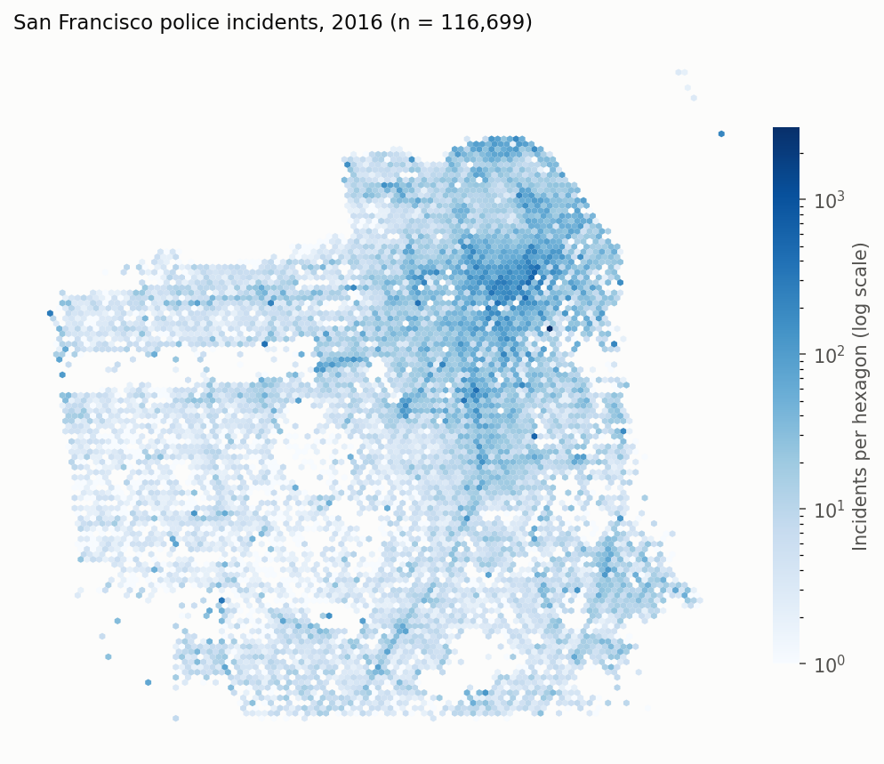

# San Francisco Police Incident Mapping

Where and when were police incidents recorded in San Francisco in 2016, and which kinds dominate? This project validates the SFPD incident extract, corrects the unit of analysis from offense rows to incidents, and maps the result with Folium and a static density map.

## Key results

| Measure | Value |
|---|---:|
| Incidents (offense records) | 116,699 (150,500) |
| Offenses per incident | 1.29 |
| Largest category: larceny/theft | 39,988 incidents, 34.3% of all incidents |
| Busiest district: Southern | 22,239 incidents, 19.1% |
| Busiest hour / quietest hour | 18:00 (6.7% of incidents) / 05:00 (1.1%) |
| Rows failing validation (coordinates, timestamps, duplicate IDs) | 0 |



Incidents concentrate in the northeast of the city: downtown, SoMa and the Tenderloin.

## Approach

- **Data validation:** schema check, timestamp parsing, a San Francisco bounding box for coordinates, and uniqueness of offense IDs (`PdId`).
- **Unit of analysis:** each source row is one offense, and one incident (`IncidntNum`) can carry several. Counting rows overstates incidents by 29%, so categories are counted both ways and districts by distinct incident.
- **Aggregation with pandas:** counts and shares by category, police district and hour of day.
- **Static geospatial visualization:** a log-scaled hexbin of all incident coordinates with matplotlib.
- **Interactive mapping:** a Folium (Leaflet) map with `MarkerCluster` over a seeded 500-incident sample, which keeps the page responsive.

## Data

[Police Department Incidents, Previous Year (2016)](https://data.sfgov.org/), San Francisco Police Department via DataSF, as mirrored by IBM Skills Network for the IBM Data Visualization with Python course. The compressed copy in `data/raw/` and its checksums are listed in [`data/SOURCES.json`](data/SOURCES.json). Check DataSF's terms before reuse.

- **Unit:** one incident (one or more offense rows).
- **n:** 116,699 incidents, 150,500 offense rows.
- **Time span:** January 1 to December 31, 2016.

## Repository structure

```text
analysis.py               # validation, aggregation, density figure, Folium map
sf_crime_folium.ipynb     # walkthrough with tables, charts and the interactive map
data/raw/                 # sf_incidents_2016.csv.gz
data/SOURCES.json         # source URL and checksums
outputs/                  # metrics.json, category/district counts, map sample, figures/
tests/test_analysis.py
```

## Reproduce

```bash
python3.12 -m venv .venv && source .venv/bin/activate
pip install -r requirements.txt
python analysis.py --write-map    # also writes outputs/incident_map.html
pytest -q
jupyter nbconvert --to notebook --execute --inplace sf_crime_folium.ipynb
```

## Limitations

- Incident records reflect what was reported and recorded, which varies with enforcement and reporting behavior, not every event that happened.
- Counts aren't rates: there's no population, visitor or land-use denominator, so a busy district isn't necessarily a riskier one.
- The data covers one year under the district boundaries in use in 2016. SFPD redrew its districts in October 2026.
- Folium maps don't render in GitHub's notebook preview. Open the notebook in Jupyter or nbviewer.
